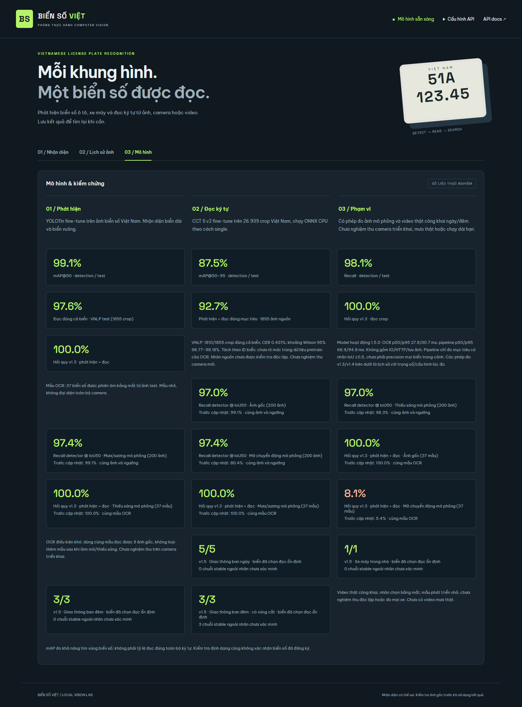

# Biển Số Việt

**Vietnamese License Plate Recognition** — dự án cá nhân nhận diện biển số ô tô và xe máy Việt Nam từ ảnh, camera và video.

Sử dụng YOLO11n để phát hiện biển số và CCT S v2 được fine-tune cho nhận dạng ký tự. Ứng dụng gồm API FastAPI, giao diện web tiếng Việt và lịch sử tra cứu bằng SQLite. Model phục vụ đã được đóng gói trong repository.



## Tính năng

- Nhận diện ảnh JPG, PNG và WebP; hiển thị hộp biển số, chuỗi ký tự, điểm tin cậy và cảnh báo chất lượng.
- Camera trình duyệt, video MP4/WebM/OGV và CLI cho USB, RTSP hoặc file video.
- Chọn vùng nhận diện (ROI), lấy mẫu khung hình và đồng thuận qua nhiều khung để giảm kết quả dao động, hạn chế lưu trùng.
- Tra cứu theo biển số/thời gian, xem ảnh bằng chứng và xuất CSV.
- Sao lưu, kiểm tra toàn vẹn và dọn lịch sử theo thời gian lưu giữ.
- Bộ công cụ chuẩn bị dữ liệu, huấn luyện, export ONNX và đánh giá có manifest/checksum.

## Kiến trúc

```text
Ảnh / camera / video → YOLO11n → crop biển số → CCT S v2 ONNX
    → kiểm tra chất lượng + đồng thuận thời gian → FastAPI → SQLite / giao diện web
```

Detector dùng CUDA khi có GPU tương thích, nếu không chạy CPU. OCR chạy bằng ONNX Runtime trên CPU với một crop RGB. Ứng dụng dùng HTML/CSS/JavaScript, không cần bước build frontend.

## Cài đặt

Khuyến nghị **Python 3.12**, Git và môi trường ảo riêng. GPU NVIDIA là tùy chọn khi chạy ứng dụng; fine-tune OCR cần môi trường CUDA riêng.

### Windows

```powershell
git clone https://github.com/JunnDung/vietnam-license-plate-recognition.git
cd vietnam-license-plate-recognition
powershell -ExecutionPolicy Bypass -File .\setup.ps1
.\run.cmd
```

Mở [http://127.0.0.1:8000](http://127.0.0.1:8000). Dùng `setup.ps1 -Cuda` để cài PyTorch CUDA, hoặc `-Python C:\path\python.exe` để chọn Python. Script tạo `.venv` trong dự án và tải baseline OCR theo checksum để phục vụ đối chiếu; OCR fine-tune đang hoạt động có sẵn trong Git.

### Linux

```bash
git clone https://github.com/JunnDung/vietnam-license-plate-recognition.git
cd vietnam-license-plate-recognition
python3.12 -m venv .venv
source .venv/bin/activate
pip install torch==2.11.0 torchvision==0.26.0 --index-url https://download.pytorch.org/whl/cpu
pip install -r requirements-lock.txt
uvicorn app:app --host 127.0.0.1 --port 8000
```

## Sử dụng

Chọn **Nhận diện** để tải ảnh hoặc chuyển sang camera/video; **Lịch sử ảnh** để tra cứu; **Mô hình** để xem số liệu. Camera trình duyệt cần localhost hoặc HTTPS. Video được giải mã trong trình duyệt, chỉ các khung JPEG được gửi tới API.

Camera/video lấy mẫu mặc định 5 lượt/giây, có thể chọn 1–10. Hình xem trực tiếp yêu cầu 30 FPS; tốc độ nhận diện thực phụ thuộc máy, cảnh và số biển trong khung. Video có thể xử lý chậm hơn thời gian thực. Mặc định video không lưu lịch sử; chỉ bật lưu khi cần giữ bằng chứng.

CLI chạy trong môi trường đã kích hoạt, khi API đang hoạt động:

```bash
python scripts/camera.py --source 0
python scripts/camera.py --source sample.mp4 --fps 5
python scripts/camera.py --source "rtsp://CAMERA_ADDRESS/stream" --fps 5 --save
```

Thêm `--roi "0,15,50,80"` để chọn vùng theo phần trăm hoặc `--burst 1` để tắt chọn khung rõ hơn. Camera được mở ở phía máy chạy CLI. Chi tiết: [hướng dẫn camera](reports/CAMERA_GUIDE.md), [vận hành và sao lưu](reports/OPERATIONS.md).

### API

Swagger UI: [http://127.0.0.1:8000/docs](http://127.0.0.1:8000/docs).

```bash
curl -X POST http://127.0.0.1:8000/api/recognize \
  -F "file=@image.jpg" -F "save=false" -F "confidence=0.35"
```

Trên Windows PowerShell, dùng `curl.exe` và viết lệnh trên một dòng.

| Endpoint | Chức năng |
|---|---|
| `GET /api/health` | Trạng thái, phiên bản, thiết bị và hash model |
| `POST /api/recognize` | Nhận diện ảnh multipart; trả biển số, bbox, confidence và trạng thái kiểm tra |
| `GET /api/history` | Tra cứu với `plate`, `since`, `until`, `limit`, `offset` |
| `GET /api/history.csv` | Xuất CSV theo bộ lọc |
| `GET /api/images/{id}` | Xem ảnh nguồn hoặc crop đã lưu |
| `DELETE /api/history/{id}` | Xóa lượt nhận diện và ảnh không còn tham chiếu |
| `GET /api/model` | Tổng hợp kết quả đánh giá |

Ảnh tối đa 10 MB, 16 triệu pixel và cạnh nhỏ nhất 32 px. `save=false` không ghi lịch sử. Camera/video gửi thêm `stream_id` UUID và `sample_time` tăng dần theo giây để dùng đồng thuận thời gian. `needs_review` có thể bật vì ảnh mờ/tối/nhỏ, OCR thấp hoặc định dạng không phù hợp; confidence cao không bảo đảm chuỗi đúng.

### Cấu hình

Đặt biến môi trường trước khi khởi động; `.env` không được tự động nạp. Xem [.env.example](.env.example).

| Biến | Mặc định | Ý nghĩa |
|---|---|---|
| `PLATE_DEVICE` | `auto` | `cpu`, `0` hoặc tự chọn CUDA |
| `PLATE_DATA_DIR` | `runtime/` | Thư mục SQLite và ảnh |
| `PLATE_API_KEY` | Trống | Khi đặt, API được bảo vệ bằng header `X-API-Key` |
| `PLATE_MIN_DETAIL` | `25` | Ngưỡng cảnh báo độ chi tiết crop |
| `PLATE_MIN_BRIGHTNESS` | `40` | Ngưỡng cảnh báo độ sáng crop |

Chạy một worker vì trạng thái đồng thuận nằm trong RAM. Khi mở dịch vụ qua mạng, cấu hình API key và HTTPS. Lịch sử/ảnh nằm tại máy chạy server; Git không chứa dữ liệu vận hành. Hệ thống không tra cứu chủ xe hoặc xác minh đăng ký biển số. API bãi xe cũ chỉ được giữ để tương thích, không thuộc giao diện hiện tại.

## Kết quả đánh giá

OCR được fine-tune trên **26.939 crop / 15.123 ID biển**, dùng **1.959 ID validation** để chọn checkpoint và cách suy luận. Test cuối gồm **1.855 ID**, tách theo nhóm ID và pixel khỏi train/validation của lần fine-tune. So sánh trên cùng các mục tiêu:

| Phép đo | Baseline 1.4 | Fine-tune 1.5 |
|---|---:|---:|
| OCR đúng toàn chuỗi | 1792/1855 · 96,60% | **1810/1855 · 97,57%** |
| CER | 0,741% | **0,431%** |
| Biển hai dòng đúng | 784/833 · 94,12% | **801/833 · 96,16%** |
| OCR CPU p50 / p95 | 58,3 / 109,0 ms | **27,8 / 30,7 ms** |
| Phát hiện và đọc đúng mục tiêu, IoU ≥0,5 | 1706/1855 · 91,97% | **1720/1855 · 92,72%** |

OCR dùng CPU Ryzen 7 6800H, hai luồng ONNX; detector dùng RTX 3060 Laptop. Độ trễ OCR không gồm detector, IO, HTTP hoặc lưu ảnh và không tương đương FPS camera. Wilson 95% cho crop exact match là **96,77–98,18%**. Số liệu detector trước đây: **99,11% mAP@50 / 87,50% mAP@50–95 trên 665 ảnh test**; đây là phép đo định vị, khác tỷ lệ đọc đúng chuỗi.

Chi tiết và dự đoán từng mẫu: [thí nghiệm OCR](reports/OCR_FINETUNE.md), [test JSON](reports/ocr_finetune_test.json), [manifest](reports/ocr_finetune_manifest.json), [kết quả video hồi quy](reports/ocr_finetune_video_regression.json). [Báo cáo DOCX](reports/Bao_cao_do_an_nhan_dien_bien_so.docx) trình bày lý thuyết, huấn luyện, kết quả và giới hạn. Các báo cáo 1.3/1.4 được giữ làm lịch sử thực nghiệm, không phải số liệu của model hiện tại.

### Giới hạn

- Nhãn VNLP lấy từ tên file, chưa được người kiểm tra độc lập toàn bộ. Chưa xác minh mức trùng nguồn với OCR pretrained và dữ liệu train detector cũ; chưa chứng minh khả năng tổng quát sang camera mới.
- Ảnh nguồn chưa gán nhãn mọi biển: phép đo pipeline chỉ xét mục tiêu có nhãn, không phải precision toàn cảnh.
- Mờ chuyển động mạnh còn yếu: **104/200** validation mô phỏng đúng cả biển, baseline **106/200**. Dữ liệu mô phỏng không thay thế mưa/đêm thật.
- Video công khai là bộ hồi quy nhỏ từng dùng phát triển. Chưa nghiệm thu USB/RTSP thực tế, mưa thật hoặc tải nhiều camera dài hạn. Cần đối chiếu ảnh và đánh giá trên camera triển khai trước khi dùng kết quả cho quyết định thực tế.

## Huấn luyện và tái lập

[Hướng dẫn OCR](reports/OCR_FINETUNE.md) mô tả nguồn dữ liệu, chia nhóm, checksum, cấu hình train, export và đánh giá. Dùng môi trường riêng theo `requirements-ocr-train-lock.txt` / `requirements-ocr-export-lock.txt`; không cài các gói training vào môi trường API.

Detector có thể được huấn luyện bằng `scripts/prepare_data.py` và `scripts/train.py`. Xem [thực nghiệm detector](reports/VALIDATION.md) để biết split và phép đo chống mờ. Không dùng lại test đã công bố để lựa chọn model mới.

```text
app.py, recognition.py, temporal.py  API, suy luận và đồng thuận thời gian
web/                               Giao diện web
models/                            Trọng số, cấu hình và nguồn model
scripts/                           Dữ liệu, training, export, đánh giá, vận hành
tests/                             Kiểm thử Python và JavaScript
reports/                           Manifest, số liệu, biểu đồ và báo cáo đồ án
```

`data/`, `runs/`, `runtime/` và môi trường ảo được loại khỏi Git. Nguồn và hash model nằm trong [models/README.md](models/README.md).

## Kiểm thử và đóng góp

```bash
python -m unittest discover -s tests -v
node --check web/app.js
node --check web/camera.js
node --check web/video.js
node tests/check_camera_js.cjs
node tests/check_video_js.cjs
```

Node.js cần cho kiểm thử bộ điều khiển, không bắt buộc khi chạy ứng dụng. Hai test backend OCR cần môi trường training; chúng được bỏ qua trong môi trường runtime. GitHub Actions chạy kiểm thử CPU khi push hoặc mở pull request.

Đóng góp qua issue hoặc pull request. Với lỗi nhận diện, mô tả điều kiện ảnh, model/hash và cách tái hiện; chỉ chia sẻ ảnh được phép công bố. Với thay đổi model, kèm baseline, protocol, mẫu số và kết quả trên validation/test tách biệt.

## Tác giả, nguồn và giấy phép

Dự án cá nhân của [JunnDung](https://github.com/JunnDung). Mã nguồn phát hành theo [AGPL-3.0](LICENSE).

- Detector: [Ultralytics YOLO11](https://github.com/ultralytics/ultralytics).
- OCR khởi tạo: [FastPlateOCR CCT S v2](https://github.com/ankandrew/fast-plate-ocr), dự án upstream dùng MIT; phiên bản này được fine-tune cho biển số Việt Nam.
- Dữ liệu detector: [Vietnam License Plate Segment Datasets](https://huggingface.co/datasets/hoanglvuit/Vietnam_License_Plate_Segment_Datasets).
- Dữ liệu OCR: [VNLP](https://github.com/fict-labs/VNLP).

Giấy phép mã nguồn không cấp lại quyền đối với dữ liệu/model bên thứ ba. Quyền tái phân phối dataset chưa được xác nhận; ảnh và video nguồn không được đóng gói trong repository. URL revision/checksum và ghi chú nguồn video được lưu trong các manifest ở `reports/`.
